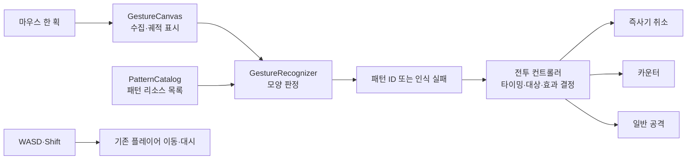

# 마우스 패턴 입력 시스템 계획

작성: 2026-10-16. 구현 전 설계이며, 인식률과 수치는 아직 실측하지 않았다.

현재 구현: 기본 네 기호와 별·소용돌이의 Resource·인식기·기존 이동 맵의 입력 및 결과 표시를 추가했다. 별은 닫힌 궤적의 시작 위치를 비교하고, 별·소용돌이에만 회전을 허용한다. 사용법은 [플레이 테스트 안내](gesture_playtest.md)를 따른다. 아래는 초기 네 기호를 기준으로 작성한 설계이며, 실험실 편집 UI와 보스 전투 연결은 후속 설계다.

## 1. 게임 전제와 설계 결론

플레이어는 WASD로 움직이고 Shift로 대시하면서 마우스로 주문을 그린다. 보스 러시를 중심으로 잡몹이 추가되며, 그리기는 일반 공격·카운터·즉사 패턴 취소에 사용한다.

**화면에서 한 획을 수집하는 부분, 모양을 판정하는 부분, 전투에서 그 결과를 사용하는 부분을 분리한다. 패턴은 코드의 분기문 대신 `.tres` 데이터로 추가한다.**

다음은 첫 프로토타입의 제안이다. 사용자 확정 사항과 구분한다.

- 그리는 동안에도 이동·대시와 전투 시간이 계속 흐른다. 자동 정지나 슬로 모션은 넣지 않는다.
- 좌클릭 누름부터 놓기까지를 한 획으로 삼고, 놓는 순간 한 번 판정한다.
- 그리는 위치와 크기, 시작 끝 방향은 자유롭게 허용한다. 모양의 화면상 방향은 구분한다.
- 일반 공격은 보스 자동 조준을 기본으로 한다. 마우스로 조준과 그리기를 동시에 요구하지 않는다. 잡몹에 적용되는 범위·효과는 주문 및 전투 규칙에서 정한다.
- 첫 패턴은 `horizontal`, `vertical`, `chevron_down`, `chevron_up` 네 종류다. 각각 `—`, `|`, `V`, `∧`에 해당한다.
- 카운터와 즉사기 취소는 우선 기호 하나로 검증한다. 여러 기호를 연속해서 그리는 요구는 필요해질 때 전투 쪽에 추가한다.

## 2. Magic Cat Academy에서 가져올 것

공식 명칭은 **Magic Cat Academy**다. 2016년작을 기본 참고 대상으로 삼는다. 2020년에는 바닷속, 2024년에는 대기권을 배경으로 후속작이 나왔다. 배경이나 후속작의 특수 기믹 전체를 재현하는 작업은 이번 범위에 없다. [2016 공식 소개](https://doodles.google/doodle/halloween-2016/), [2020 공식 소개](https://doodles.google/doodle/halloween-2020/), [2024 공식 소개](https://doodles.google/doodle/halloween-2024/)

근거의 수준을 구분한다.

| 구분 | 확인한 내용 | 이번 게임에 적용할 판단 |
| --- | --- | --- |
| 공식 설명 | 다가오는 유령 위의 기호를 그려 마법을 사용한다. | 적의 예고와 요구 기호를 연결해 읽기 쉽게 만든다. |
| 공식 제작 설명 | 시간 압박에 맞춰 복잡한 주문 문양을 줄이고 단순한 기호를 선택했다. | 이동과 회피까지 더해지므로 짧고 구별되는 기호로 시작한다. |
| 직접 관찰 | 2016 튜토리얼은 화면 어디에든 기호를 그리라고 안내한다. 적의 위치에 덧그릴 필요가 없다. | 입력을 적 좌표나 월드 좌표에 묶지 않는다. |
| 직접 입력 확인 | 가로선을 오른쪽→왼쪽, 세로선을 아래→위로 그려도 튜토리얼이 진행됐다. | 기본 네 기호는 역방향 획도 같은 패턴으로 처리한다. |
| 게임 설계 해석 | 원작의 정지한 캐릭터는 시선과 손을 기호 처리에 집중하게 한다. | 이동형 게임에서는 보스 예고를 보면서 짧게 그릴 수 있어야 한다. |

직접 확인은 공식 [2016 실행본](https://www.google.com/logos/2016/halloween16/halloween16.html)의 초기 튜토리얼 범위다. 원작 내부 인식 알고리즘·정확한 허용 오차·후반 전투 규칙은 확인하지 않았다. 아래 구조는 원작 구현에 대한 추정이 아니라 이 프로젝트를 위한 제안이다.

## 3. 입력에서 전투까지



`GestureRecognizer`는 보스·잡몹·피해량·카운터 윈도를 모른다. 같은 궤적과 같은 카탈로그에는 같은 결과를 낸다. 현재 보스가 원하는 패턴만 후보로 넣어 억지로 정답을 만들지 않는다.

### 입력 규칙

| 상황 | 처리 |
| --- | --- |
| UI 밖에서 좌클릭 시작 | 첫 좌표와 시작 시각을 기록한다. |
| 누른 채 이동 | 마우스 이벤트의 좌표를 수집하고 선분을 이어 그린다. 키보드 이동은 계속된다. |
| 좌클릭 해제 | 마지막 좌표와 해제 시각을 기록한 뒤 한 번 판정한다. |
| 우클릭 또는 그리는 중 Escape | 현재 획을 취소한다. 주문은 발동하지 않는다. |
| 창 포커스 상실·창 밖 이탈·일시정지·사망·씬 교체 | 현재 획과 궤적을 비우고 입력 설정을 복원한다. |
| 시작 클릭을 UI가 소비함 | 그리기를 시작하지 않는다. |
| 클릭만 함·너무 작은 낙서·중복 좌표뿐임 | 크기 정규화 전에 거절한다. |
| 놓기 이벤트 누락 | 이후 버튼 상태로 감지하면 취소한다. 다음 클릭과 연결하지 않는다. |

UI 위에서 시작한 입력을 막으려면 시작은 `_unhandled_input()`에서 받는다. 획이 시작된 뒤에는 `_input()`에서 해당 마우스 이동·해제를 받아 처리하고 소비한다. 그러면 드래그 도중 UI 위를 지나 놓아도 입력이 고착되거나 UI 버튼이 눌리는 문제를 줄일 수 있다. 키보드 이벤트를 일괄 소비하지 않는다. [Godot 입력 전달 순서](https://docs.godotengine.org/en/stable/tutorials/inputs/inputevent.html)

### 이동 카메라와 입력 품질

- `CanvasLayer` 아래의 고정된 화면 좌표에서 수집·표시한다. 플레이어의 월드 좌표나 카메라 변환을 궤적에 섞지 않는다.
- 현재 프로젝트는 `canvas_items` 스트레치와 4배 확대 추적 카메라를 쓴다. 같은 화면 좌표계를 끝까지 사용하고, 비균일한 X/Y 보정을 하지 않는다.
- 그리는 중 창 크기나 뷰포트 변환이 바뀌면 현재 획을 취소한다. 서로 다른 좌표계의 점을 이어 붙이지 않는다.
- 마우스 이동은 `_process()`에서 프레임당 한 번 읽는 대신 `InputEventMouseMotion`으로 받는다.
- 그리는 동안 `Input.use_accumulated_input = false`로 설정하고, 종료·취소·노드 해제 시 이전 값을 복원한다. 전역 설정이므로 그리기 컴포넌트 하나가 소유한다. Godot은 기본적으로 이동 이벤트를 렌더링 프레임 단위로 합칠 수 있다. [공식 문서](https://docs.godotengine.org/en/stable/classes/class_inputeventmousemotion.html)
- 조밀한 중복 점만 줄이고 꺾이는 점은 보존한다. 화면에는 점 사이를 연결해서 표시한다. 보간으로 표시를 매끄럽게 해도 이미 누락된 꺾임을 복구할 수는 없다.
- 점 개수에는 안전 상한을 둔다. 초과하면 획 전체를 취소하고, 앞부분만 잘라 주문으로 인정하지 않는다.

## 4. 인식 방법

**`$1`의 등간격 재표본화와 템플릿 거리 비교를 이용하되, 회전 정규화를 제거하고 종횡비를 보존한다.** 기본 알고리즘을 그대로 가져오는 방식과는 다르다.

`$1`은 한 획을 예시 궤적과 비교하는 간단한 방식이다. 원 논문도 기본 회전 불변성으로는 방향이 다른 모양을 구별할 수 없고, 가로·세로선에는 비균일 스케일링이 문제가 될 수 있음을 설명한다. 이 게임에는 `—`/`|`, `V`/`∧` 구분이 필요하다. [연구자 공식 자료](https://depts.washington.edu/acelab/proj/dollar/index.html), [논문 Limitations 절](https://faculty.washington.edu/wobbrock/pubs/uist-07.01.pdf)

처리 순서는 다음과 같다.

1. 연속 중복 좌표를 제거한다. 점이 부족하거나 전체 길이·외곽 크기가 너무 작으면 거절한다. 가로선은 면적이 0일 수 있으므로 외곽 사각형의 면적으로 유효성을 판단하지 않는다.
2. 궤적 길이를 기준으로 **64개 점**에 재표본화한다. 입력 속도와 이벤트 개수 차이를 줄인다. 끝점을 보존하고 길이 0인 선분 및 부동소수점 오차를 처리한다.
3. 외곽 사각형의 긴 변이 1이 되도록 X/Y를 **같은 배율**로 줄인다. 폭·높이가 각각 1이 되도록 늘리지 않는다.
4. 점들의 평균 위치를 원점으로 옮긴다. 회전하거나 반사하지 않는다.
5. 입력과 각 예시의 대응 점 평균 거리를 계산한다. 입력 점의 정방향·역방향 중 더 가까운 값을 쓴다.
6. 예시별 점수가 아니라 **패턴 ID별 최솟값**을 구한다. 가장 좋은 패턴과 두 번째로 좋은 다른 패턴의 거리를 비교한다.
7. 최상위 오차가 그 패턴의 `max_error` 이하여야 하고, 다른 패턴과 충분히 차이가 나야 성공이다. 나머지는 실패로 돌려준다.

```text
distance(A, B) = mean(length(A[i] - B[i]))
error(pattern) = min(distance(input, sample), distance(reverse(input), sample))
                 over all samples belonging to that pattern

성공 조건:
  best_error <= best_pattern.max_error
  second_distinct_pattern_error - best_error >= ambiguity_margin
```

후보가 하나뿐이면 두 번째 조건은 생략한다. 실패하면 성공용 패턴 ID를 비운다. 디버그 출력에는 후보·오차·실패 이유를 남길 수 있다. 오차는 유사도를 비교하는 값이며 성공 확률이 아니다.

- `V`를 오른쪽 끝부터 그려도 `V`다. `∧`나 90도 돌아간 모양까지 같은 기호로 허용하지 않는다.
- 약간 기울거나 폭이 다른 실제 손그림은 예시를 추가해 허용한다. 처음부터 기호별 분기 알고리즘이나 자유 회전 옵션을 만들지 않는다.
- 예시는 로딩 때 한 번 정규화해서 캐시한다. 실행 중에는 입력만 처리한다. 비용은 예시 개수에 비례하며, 스레드나 외부 인식 서버는 필요하지 않은 규모로 시작한다.
- 네 기호는 모두 열린 한 획이다. 원·하트처럼 닫힌 도형을 추가할 때는 시작점 위치 문제도 검증해야 한다. 역방향 비교만으로 임의의 시작점을 해결하지는 못한다.

처음부터 임계값을 확정하지 않는다. `max_error`, 모호함 차이, 최소 입력 크기는 아래 실입력 자료로 조정한다. 특히 회피 중 짧고 찌그러진 입력과 대각선·낙서의 오인식 사이를 확인해야 한다.

## 5. 패턴 데이터와 관리

패턴 하나를 `PatternDefinition` 커스텀 Resource 하나로 저장한다. Godot은 커스텀 리소스의 Inspector 편집과 `.tres` 저장을 지원한다. JSON 파서나 별도 데이터베이스는 추가하지 않는다. [Godot Resources](https://docs.godotengine.org/en/stable/tutorials/scripting/resources.html)

| 필드 | 자료형 | 용도 |
| --- | --- | --- |
| `id` | `StringName` | 전투에서 참조하는 고유 ID. 표시 이름이나 파일 이름과 분리한다. |
| `display_name` | `String` | 개발 도구에서 선택하고 식별하는 이름. |
| `samples` | `Array[PackedVector2Array]` | 허용하는 한 획 예시들. 첫 예시를 대표 모양으로 표시한다. |
| `max_error` | `float` | 이 패턴의 허용 오차. 값의 허용 범위를 검증한다. |

`PatternCatalog`는 `Array[PatternDefinition]` 하나를 가진다. Inspector에서 패턴을 추가·제외·정렬한다. 명시적 리소스 참조로 구성해 폴더 탐색이나 파일명 규칙에 의존하지 않으며, 내보낸 게임에도 의존 리소스가 포함되도록 한다.

로딩 시 빈 ID, 중복 ID, 빈/퇴화 예시, 유한하지 않은 좌표, 잘못된 임계값을 검증한다. 잘못된 카탈로그는 실행 가능한 상태로 조용히 넘기지 않고 파일과 원인을 표시한다. 전투 데이터의 패턴 참조도 같은 카탈로그에 존재하는지 확인한다.

### 패턴 실험실: 큰 에디터 플러그인 대신 작은 개발용 씬

`PatternLab`에서 다음 작업을 제공한다.

- 카탈로그의 패턴 목록과 대표 모양 표시.
- **테스트 모드:** 자유롭게 그린 뒤 1·2위 ID, 오차, 성공/실패 이유 표시.
- **예시 편집 모드:** 선택한 패턴에 예시 추가, 선택 예시 교체·삭제, 저장 전 미리보기.
- 저장 버튼을 누를 때만 해당 `.tres`에 반영. 저장 실패를 표시하고 기존 정상 파일을 잃지 않도록 검증 후 저장한다.
- 임계값과 ID·이름은 우선 Inspector에서 편집한다. 패턴 생성·목록 편집까지 전부 별도 UI로 중복 구현하지 않는다.
- 실험실은 개발 환경에서만 프로젝트 리소스를 저장한다. 배포 게임에는 리소스 편집·저장 기능을 연결하지 않는다.

작업 흐름은 다음과 같다.

| 하고 싶은 일 | 수정 범위 |
| --- | --- |
| 새 열린 한 획 패턴 추가 | Resource 생성 또는 복제 → 새 ID 지정 → 실험실에서 예시 기록 → catalog에 등록 → 인식 충돌 검사. 인식기 코드 수정 없음. |
| 같은 패턴을 더 너그럽게 인식 | 놓치는 입력을 살펴보고 대표성 있는 예시나 `max_error` 조정 → 모든 기존 패턴 재평가. |
| 모양 변경 | ID를 유지하고 예시를 교체한다. 기존 입력도 허용할지에 따라 이전 예시를 남기거나 지운다. |
| 표시 이름·파일명 변경 | ID를 유지한다. 전투 참조 의미는 유지된다. |
| 패턴 삭제·ID 변경 | 보스 예고·공격 설정·테스트 자료의 참조를 먼저 갱신하고 검증한다. |
| 기존 패턴을 새 보스에서 사용 | 보스 공격 데이터가 ID를 참조한다. 모양 인식기 수정 없음. |
| 새로운 공격 효과 추가 | 전투 효과 코드는 필요할 수 있다. 모양 인식과 분리해 수정한다. |

Resource에는 적별 진행 상태나 현재 카운터 타이머를 저장하지 않는다. 공유 로딩되는 패턴 데이터는 읽기 전용으로 사용하고, 전투 상태는 각 노드가 소유한다.

## 6. 보스 러시에서의 사용 규칙

인식 결과의 의미는 전투 컨트롤러가 결정한다. 향후 보스 공격 데이터는 `required_pattern_id`, 예고 시작, 유효 윈도, 성공 효과를 갖게 한다. 시간의 시작·진행 상태는 런타임 데이터다.

| 용도 | 성공 조건 | 결과 |
| --- | --- | --- |
| 일반 공격 | 인식 성공 + 해당 패턴에 연결된 일반 주문 사용 가능 | 보스 자동 조준 등의 규칙에 따라 공격한다. |
| 카운터 | 예고에 지정된 ID + 카운터 유효 시간 안에 획 완성 | 해당 보스 공격에 정의된 카운터 효과를 실행한다. |
| 즉사기 취소 | 해당 즉사 예고의 ID + 취소 유효 시간 안에 획 완성 | 해당 공격 인스턴스만 취소하고 성공 피드백을 낸다. |

첫 프로토타입의 판정 정책:

1. 인식 실패면 공격을 발동하지 않는다. 실패 때문에 이동을 멈추거나 별도 경직을 주지 않는다.
2. 인식 성공 시 유효한 **즉사기 취소 → 카운터 → 일반 공격** 순서로 하나만 선택한다. 성공한 카운터의 피해는 카운터 효과가 담당하며 일반 주문을 중복 발동하지 않는다.
3. 같은 우선순위의 요청이 겹치면 마감이 빠른 요청, 이후 고유 요청 ID 순으로 결정한다. 하나의 획이 여러 보스/잡몹 예고를 일괄 취소하지 않는다.
4. 특별 요청의 기호가 다르거나 시간이 맞지 않으면 그 요청은 유지한다. 사용 가능한 일반 주문이 있으면 일반 공격으로 처리한다. 모양 실패와 타이밍 실패는 실험실에서 구분해 볼 수 있게 한다.
5. 특별 요청은 **예고가 나타난 뒤 시작한 획**만 허용한다. 클릭을 오래 잡고 있다가 예고 직후 놓는 사전 충전을 막는다. 예고를 보고 먼저 그리기 시작해 유효 윈도 안에 놓는 것은 허용한다.
6. 판정 기준 시각은 인식 계산이 끝난 시점이 아니라 **해제 입력을 받은 시각**이다. 시작·해제와 보스 윈도는 같은 단조 증가 시계를 사용한다. 유효 구간은 `[open, close)`로 통일한다.
7. 요청은 고유 ID로 한 번만 소비한다. 씬 교체·보스 사망·페이즈 종료 시 지난 요청을 폐기한다. 일시정지에서는 획을 취소하고, 재개 시 보스 마감 시각을 정지 시간만큼 보정한다.

이 정책과 자동 조준은 조작 부담을 줄이기 위한 제안이다. 실제 전투 테스트에서 조정하더라도 인식기와 패턴 데이터 구조는 그대로 사용할 수 있다.

### 예고와 화면 가독성

- 카운터/즉사 예고는 기호와 남은 시간 표시를 함께 사용한다. 색만으로 구분하지 않는다.
- 기호는 보스 또는 해당 공격의 예고에 연결한다. 여러 곳의 동일한 표시 때문에 성공 대상이 불명확해지지 않게 한다.
- 입력 궤적은 보스의 공격 예고보다 낮은 시각적 우선순위로 표시하고, 손을 놓으면 빠르게 정리한다. 불투명한 그리기 패널로 전장을 덮지 않는다.
- 초기에는 즉사기와 카운터의 동시 요구를 피한다. 잡몹의 수·속도·공격 겹침과 기호 그리기 시간을 함께 조정한다.
- 첫 기호들은 짧은 선 또는 한 번 꺾는 모양이다. 복잡한 문양을 추가하기 전에 회피 중 완성 시간과 실패 이유를 측정한다.

## 7. 이 프로젝트에 적용할 파일 범위

현재 확인: `scripts/gameplay/player.gd`에 이동·대시·사망 신호가 있고 `scenes/gameplay/player.tscn`에 추적 카메라가 있다. `project.godot`에는 이동·대시 입력이 등록되어 있다. 확인한 게임 로직에는 패턴 인식·보스 전투 관리자가 아직 없다.

다음은 구현 시 추가할 예정인 파일이다. 이 문서 작성 단계에서는 만들지 않는다.

```text
scripts/gestures/
  pattern_definition.gd       # 패턴 데이터 형식
  pattern_catalog.gd          # 명시적 패턴 목록
  gesture_recognizer.gd       # 씬 없이 실행 가능한 모양 비교
  gesture_canvas.gd           # 입력 수집·궤적·시작/완료/취소 신호
  pattern_lab.gd              # 개발용 테스트·예시 편집 UI
resources/patterns/
  catalog.tres
  horizontal.tres
  vertical.tres
  chevron_down.tres
  chevron_up.tres
scenes/gestures/gesture_canvas.tscn
scenes/tests/pattern_lab.tscn
tests/test_gesture_recognizer.gd
tests/fixtures/gestures/      # 템플릿과 분리한 실제 평가 입력
```

연결할 곳과 영향:

- `project.godot`: `draw_pattern` 액션을 좌클릭에 연결한다. 기존 WASD·Shift 액션은 계속 사용한다.
- `scenes/sandbox/test_scene.tscn` 또는 이후 전투 씬: 화면 그리기 컴포넌트를 하나 배치한다. 씬 컨트롤러가 완료 신호를 받아 인식기로 넘긴다.
- 플레이어의 기존 `died` 신호: 사망 시 현재 획을 취소한다. 인식기 코드를 `player.gd`에 넣지 않는다.
- 이후 보스/전투 컨트롤러: 패턴 ID와 획 시각을 받아 위 전투 정책을 실행한다. 별도 전역 이벤트 버스나 Autoload는 우선 추가하지 않는다.
- 기존 `tests/test_player.gd`: 이동·대시 회귀 확인에 사용한다. 그리기와 동시 입력, 포커스 상실·사망 취소도 통합 확인한다.
- 내보내기: catalog와 연결된 패턴 리소스가 포함되는지 실제 내보낸 빌드에서 확인한다. 개발용 저장 기능은 배포 플레이 흐름에서 접근할 수 없어야 한다.

## 8. 구현 순서와 완료 기준

| 단계 | 작업 | 다음 단계로 넘어갈 기준 |
| --- | --- | --- |
| 1 | 패턴 Resource, catalog, 순수 인식기, 네 기호 | 정상·역방향·위치/크기 변경을 통과하고 가로/세로 및 V/∧가 섞이지 않는다. |
| 2 | 입력·궤적과 PatternLab | 예시 추가·교체·삭제 후 저장·재실행이 가능하다. 클릭/낙서가 주문으로 강제 인식되지 않는다. |
| 3 | 기존 이동 씬에 연결 | WASD·대시 중에도 같은 궤적을 인식하고 카메라가 움직여도 화면 선이 휘지 않는다. |
| 4 | 작은 전투 검증 씬 | 일반 공격·카운터·즉사기 취소 각각 한 예제로 시간 경계와 입력 중복 소비를 확인한다. |
| 5 | 실제 손입력 보정과 내보낸 빌드 | 보류한 평가 자료에서 목표를 확인하고 리소스 누락 및 개발용 저장 노출이 없다. |

인식기 자동 검증은 기존 `SceneTree` + `assert` 테스트 형식을 따른다. 테스트 프레임워크를 추가하지 않는다.

- 빈 입력·한 점·같은 점 반복·미세 떨림·수평/수직 선의 폭/높이 0에서도 오류가 없어야 한다.
- 평행 이동·균일 확대/축소·역방향 입력은 같은 ID여야 한다. 90도 회전한 가로선은 세로선이어야 한다.
- 템플릿의 예시 두 개가 1·2위를 차지해도 서로 다른 패턴 사이의 모호함으로 잘못 판단하지 않아야 한다.
- 느린/빠른 입력처럼 점 분포가 달라도 같은 경로는 같은 결과여야 한다. 보존되지 않은 꺾임까지 복원한다고 가정하지 않는다.
- 대각선·불완전한 V·지그재그·임의 낙서 등 미등록 모양을 거절할 수 있어야 한다.
- 카운터 시작/마감 경계, 예고 전 시작한 획, 한 획의 중복 소비, 무효가 된 요청을 검증한다.

실입력 파일에는 의도한 ID 또는 `unknown`과 원본 점을 저장한다. 개발용 예시·임계값 조정 자료·최종 평가 자료를 분리한다. 최종 평가는 가능하면 별도 참가자/세션에서 기호당 30개 이상과 unknown 100개 이상을 모아, 정상 인식 95% 이상·다른 기호로의 오인식 1% 이하·unknown의 잘못된 주문 발동 2% 이하를 초기 목표로 둔다. 이는 작은 파일럿의 목표이며 보장된 성능이나 통계적 확증은 아니다. 기호별 혼동과 회피 중 입력 결과도 따로 확인한다.

30/60/144 FPS, 창 크기 변경, 빠른 마우스 이동, 이동·대시 병행 조건을 확인한다. 성능 목표는 기준 PC에서 해제 후 결과 표시가 다음 화면 갱신을 지연시키지 않는 것으로 잡고, 인식 시간도 기록한다.

## 9. 이번에 생략하는 것과 남은 위험

머신러닝 모델, 외부 인식 API, 다중 획, 원·하트의 임의 시작점 처리, 전체 에디터 플러그인, 사용자 모드 지원, 원작의 특수 주문 전체와 보스 전투 구현은 현재 범위에서 생략한다.

가장 큰 위험은 회피 중 입력이 충분히 관대하면서 낙서를 주문으로 오인하지 않게 만드는 조정이다. 특히 즉사기 실패가 판정 탓으로 느껴지지 않는지 실제 조작으로 확인해야 한다. 현재는 조사·설계 문서만 작성했으며 게임 코드 변경과 런타임 검증은 하지 않았다.
